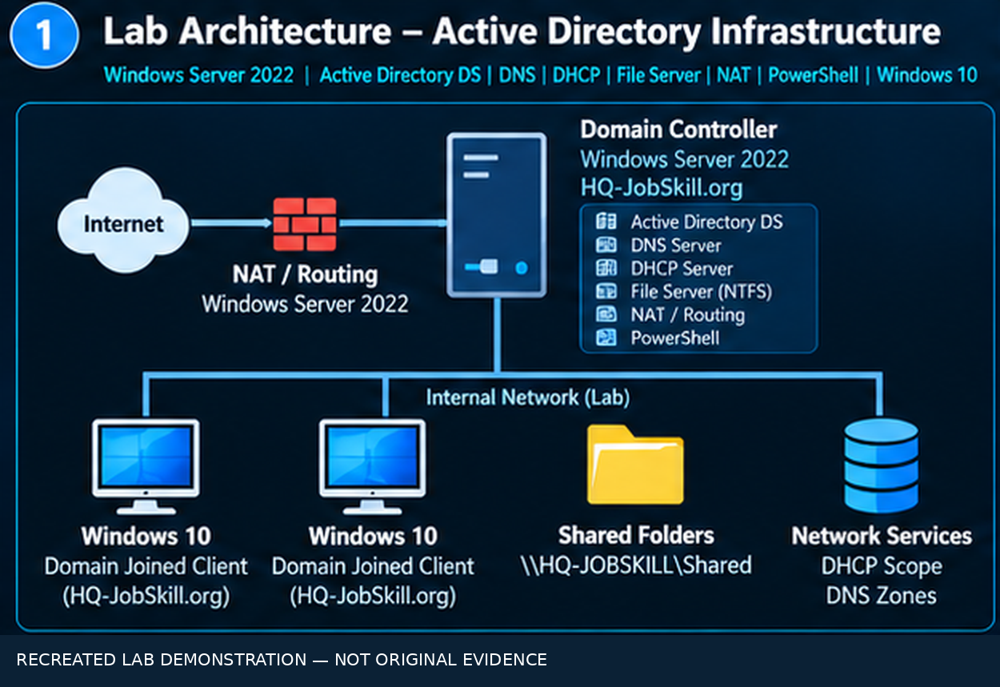
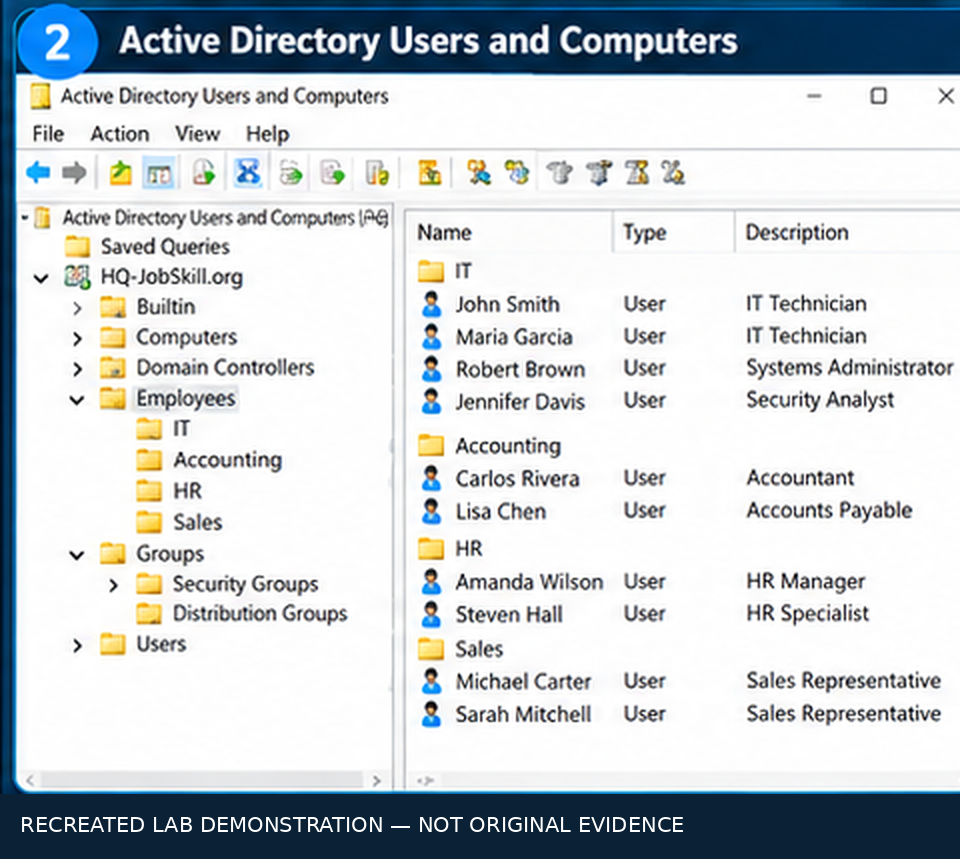
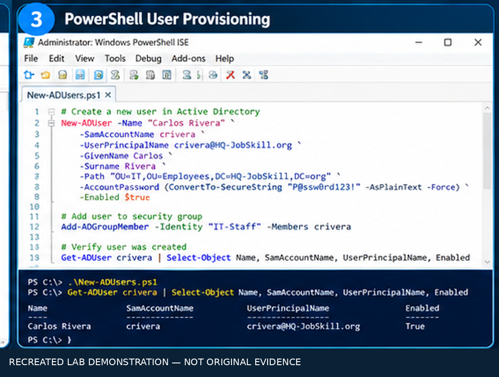
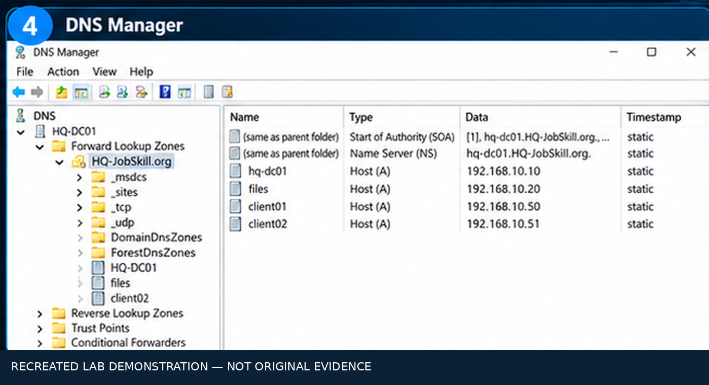
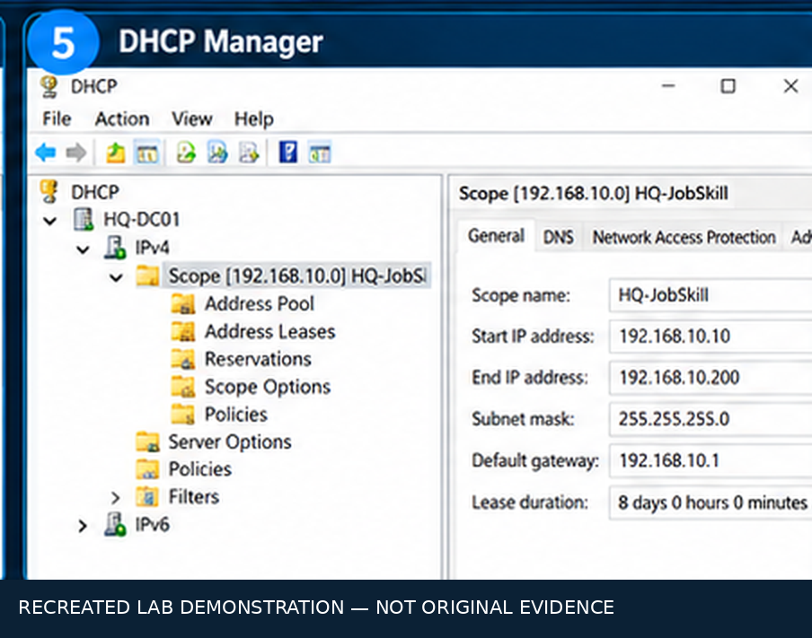
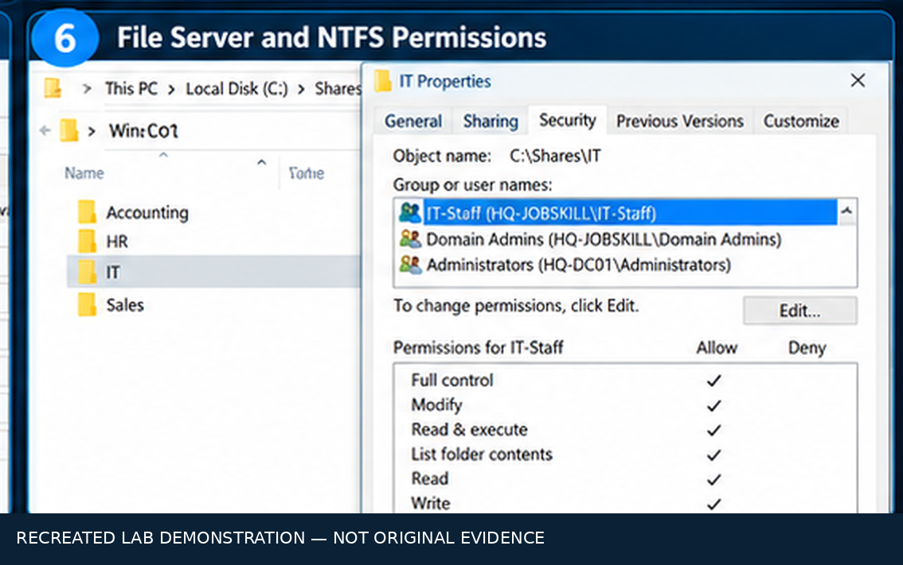
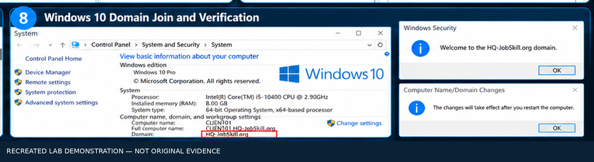

# Windows Server 2022 — Active Directory Infrastructure & Identity Management Lab

**Windows Server 2022 | Active Directory Domain Services | DNS | DHCP | PowerShell | File Services | NAT/PAT | Windows 10**

**Lab status:** Completed / Decommissioned  
**Lab domain:** `HQ-JobSkill.org`

## Overview

This completed home lab explored Windows Server infrastructure administration and identity management. I configured an Active Directory domain controller, created and managed users, practiced PowerShell-based account provisioning and maintenance, and configured supporting DNS, DHCP, file services, NTFS permissions, storage quotas, and remote access routing/NAT features. Windows 10 served as the client operating system.

The original lab has since been decommissioned. Six screenshots from the original user-provisioning walkthrough were retained; additional visuals below are **recreated demonstrations, not original screenshots or independent proof of historical configuration**.

## Architecture

*Recreated Lab Demonstration — Not Original Evidence. Diagram values and topology details are illustrative unless otherwise supported by the retained screenshots.*

## Technologies and Scope

| Component | Lab activity |
| --- | --- |
| Windows Server 2022 | Domain controller and infrastructure services |
| Active Directory DS | User, group, and domain administration |
| PowerShell | User provisioning, maintenance, and deprovisioning exercises |
| DNS | Windows DNS service configuration |
| DHCP | Address assignment and scope administration |
| Windows File Services | Shares, quotas, and NTFS access permissions |
| Remote Access / Routing | NAT/PAT configuration |
| Windows 10 | Client operating system and domain administration |

## Original Lab Evidence: Creating Active Directory Users

The following **six images were retained from the original lab**. They document the Active Directory Users and Computers workflow. They should not be interpreted as evidence for every additional service described in this README.

### 1. Open Active Directory Users and Computers

In Windows Server Manager, open **Tools → Active Directory Users and Computers**.

### 2. Navigate to the Domain

Expand `HQ-JobSkill.org` and navigate to the container or organizational unit where the user account will be created.

### 3. Start the New User Wizard

Select **New → User** from the appropriate location in Active Directory Users and Computers.

### 4. Enter User Information

Complete the account details and logon name according to the lab's naming convention.

### 5. Configure Account Options

Set the initial password and applicable account options in the user creation wizard.

### 6. Complete User Provisioning

Finish the wizard and review the newly created user in Active Directory Users and Computers.

## Recreated Lab Demonstrations

> **Disclosure:** The following interface illustrations were reconstructed after the lab was decommissioned. They are educational visualizations of the types of administrative tasks performed, **not screenshots captured from the original environment**. Usernames, addresses, scripts, and other example values shown in the recreations may differ from the original lab.

### Active Directory Users and Computers

Illustrates users, groups, and organizational units in a Windows domain.

### PowerShell User Provisioning

Illustrates PowerShell-based user creation and account management. Any command text visible in the illustration is conceptual; it should be independently tested before use.

### DNS Administration

Illustrates DNS Manager and domain-related records.

### DHCP Administration

Illustrates DHCP scopes and address allocation settings.

### File Server and NTFS Permissions

Illustrates shared-folder administration and security group permissions.

### NAT/PAT and Routing

The original lab included Remote Access routing and NAT/PAT configuration. A separate reconstructed NAT illustration has not yet been added to this repository.

### Windows 10 Domain Administration

Illustrates a Windows 10 client's domain membership and related administration.

## Security and Administration Concepts

- **Identity lifecycle:** Provision, maintain, and deprovision accounts using directory administration and scripting.
- **Least privilege:** Use group-based permissions and appropriate NTFS access controls for file resources.
- **Core network services:** Understand how DNS and DHCP support domain-connected clients.
- **Network access:** Configure routing and address translation in a lab environment.
- **Operational discipline:** Test changes, document configuration, and verify access before production deployment.

## Project Outcome

Completed a Windows Server 2022 lab focused on Active Directory identity administration and supporting infrastructure services. The environment was later decommissioned, so the original user-creation screenshots remain the primary retained visual evidence. The additional illustrations are clearly identified as recreations for educational and portfolio presentation purposes.
